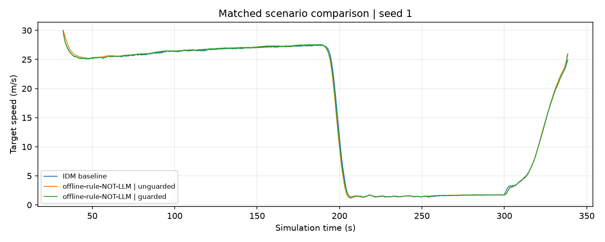
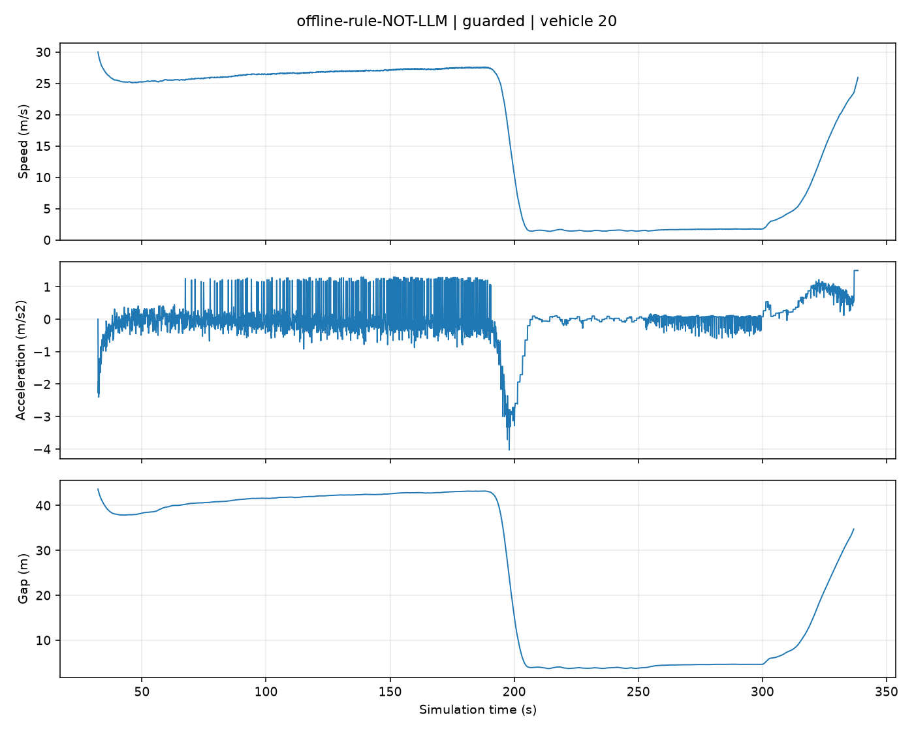
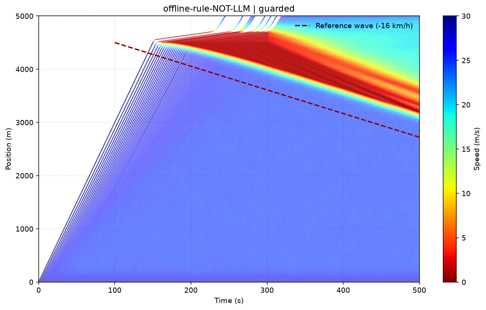

# Coursework Part II: Exploring LLM-Based Vehicle Longitudinal Control

**Technical draft — offline experiments and a separate real Zhipu pilot**

Student name/ID: [complete yourself]  
Date: 13 November 2026  
Source: [gotrafficgo/teaching_artificial_intelligence](https://github.com/gotrafficgo/teaching_artificial_intelligence),
commit `9a324d9ce9671a11184c4e8f1f9555fb0d8ea2c1`.  
Working repository: [Xzx20041023/teaching_artificial_intelligence](https://github.com/Xzx20041023/teaching_artificial_intelligence).

## 1. Introduction and objectives

The coursework explores whether a language model can supply longitudinal vehicle
control decisions within an existing simulation. This implementation preserves
the supplied road and motion model, adds a language-model interface, and examines
the integration using reproducible offline experiments. The objectives are to
establish an IDM baseline, implement observation-to-acceleration communication,
handle invalid or unavailable model responses, and produce interpretable
trajectory and safety measurements.

An offline following rule validates the control pipeline; a fault-injection
policy validates recovery; a mocked HTTP response validates the transport
contract. A later pilot uses the real Zhipu `glm-4-flash-250414` service, listed
as free in its official documentation. Its setup, results and limitations are
reported separately in [the real-model experiment](PART2_ZHIPU_RESULTS.md).
Offline measurements below are not evidence of language-model performance.

## 2. Methodology and implementation

### 2.1 Existing framework

The original simulation generates vehicles, applies road conditions, computes all
accelerations from the same pre-update traffic state, updates motion, and records
trajectories. Speed is constrained to be nonnegative and acceleration is bounded
between -8 and 1.5 m/s2. Position uses the average of old and new speeds over the
0.1 s step. The IDM controller supplies the conventional comparison.

Experiment 1 uses a 5,000 m road, desired free-flow speed 30 m/s, 5 m vehicles,
scheduled arrivals every 1.7 s, and a temporary low-speed region from 4,500 to
4,700 m. The region is active from 100 to 300 s, with desired speed 2 m/s for
affected vehicles. The bottleneck influence probability is 0.7. The supplied
entry-time rule is retained. This is a single-lane model without lane changing.

### 2.2 Experimental controller

Only vehicle 20 uses the experimental policy. Other vehicles retain IDM. The
observation contains position, speed, previous applied acceleration, desired road
speed, bumper gap, front-vehicle speed, relative speed and decision interval.
Relative speed equals ego minus leader speed. Missing leaders are represented by
JSON nulls. The policy returns a JSON numeric acceleration.

`LLMVehicle` inherits the IDM implementation so that every 0.1 s step has a fresh
fallback action. Successful policy commands are held for 1 s or 2 s, depending on
the experiment. Invalid JSON, missing/non-numeric/nonfinite acceleration values,
timeouts and other request failures invalidate the held command. The vehicle
then uses fresh IDM actions until the next valid policy decision. Finite outputs
are clipped to the physical acceleration bounds.

The optional guard is checked at every simulation step. When bumper gap is less
than 2 + 1.5v metres or closing time-to-collision is below 4 s, acceleration is
restricted to the smaller of the policy and IDM actions. This heuristic shares
the baseline controller and does not prove collision avoidance. Every guard and
fallback application is counted.

### 2.3 Offline and API adapters

The offline controller uses:

```text
free_action = 0.5 * (desired_speed - speed)
following_action = 0.15 * (gap - (2 + 1.2 * speed)) - 0.7 * relative_speed
action = clip(min(free_action, following_action), -8, 1.5)
```

Without a leader, only the free-road term is used. This is an explicit rule,
not a language model, learned policy or approximation of measured LLM responses.

The separate HTTP adapter sends system instructions and a JSON observation to a
configured `/chat/completions` endpoint. URL, model and optional key come from
environment variables. API execution requires `--policy api --allow-api` and has
an explicit request cap. Credentials are excluded from logs; redirects are
disabled. The subsequent Zhipu pilot tests one real service; other providers
remain unverified. JSON mode is optionally enabled through `LLM_JSON_MODE=1`.
The full system prompt is saved as `prompt.txt` alongside each experiment.

### 2.4 Reproducibility and measurement

Arrival schedules and per-vehicle bottleneck traits are precomputed. Vehicle
noise uses independent seeded generators, avoiding changes to external inputs
when policy code consumes random numbers. Scenario fingerprints match across
controller variants for each seed. Actual admission can differ if the entrance
is blocked. This matched suite uses a different random-stream arrangement from
the original entry point; its IDM baseline is recomputed within the suite.

Full-fleet trajectories remain local because of file size. The repository
contains compact target trajectories, per-step control traces, decision logs,
figures, summary JSON/CSV and execution metadata with Python-source hashes.
Latencies recorded here measure local offline function execution only.

## 3. Experiments and observed results

All main runs last 500 s. The 1 s suite contains three controller variants for
each of seeds 1, 2 and 3 (nine runs). A second nine-run suite changes the holding
interval to 2 s. A fault-injection suite contains three variants at seed 1.
In total, there are 21 documented runs, including repeated matched baselines.

### 3.1 One-second policy interval

The following values are arithmetic means across three seeds. Each minimum gap
is computed for the target vehicle within one run, then averaged; it is not the
minimum gap across the entire fleet. Jerk is the finite difference of applied
acceleration, excluding the initial placeholder sample.

| Controller | Target minimum gap (m) | Target acceleration RMS (m/s2) | Target jerk RMS (m/s3) | Target travel time (s) |
| --- | ---: | ---: | ---: | ---: |
| IDM | 3.224 | 0.551 | 2.617 | 305.967 |
| Offline rule, no guard | 2.848 | 0.522 | 0.388 | 305.833 |
| Offline rule + IDM guard | 3.662 | 0.624 | 5.365 | 305.967 |

All three variants admit 295 vehicles in each run. They complete 127 trips at
seeds 1 and 2 and 126 at seed 3. No sampled leader/follower overlap occurs in
these runs. This observation is limited to the tested cases and sampling rate;
it is not a general safety guarantee.

The rule has lower measured jerk than the noisy IDM baseline, but also a smaller
target minimum gap. Guarding increases the target minimum gap in all three
seeds, while producing substantially higher jerk. The guard switches between a
held rule action and fresh, noisy IDM actions; the per-step traces are consistent
with this switching contributing to acceleration fluctuations. This is an
interpretation of the traces, not a separate causal isolation experiment.

The guarded target uses 307, 306 and 307 decisions and 1,814, 1,782 and 1,804 guard
steps for seeds 1–3, respectively. Guard intervention is therefore substantial.
The trajectory must be described as hybrid control. There is no observed trip
completion benefit at this resolution, and no basis for a network-wide claim.







The dashed reference line in the time-space diagram is inherited from the
teaching code. It is an assumed -16 km/h reference, not a fitted wave-speed result.

### 3.2 Two-second policy interval

| Controller | Mean target minimum gap (m) | Mean target jerk RMS (m/s3) |
| --- | ---: | ---: |
| IDM | 3.224 | 2.617 |
| Offline rule, no guard | 3.412 | 0.690 |
| Offline rule + IDM guard | 3.609 | 5.377 |

The longer interval approximately halves offline decision counts (about 154
instead of 306–307). The unguarded rule's target minimum gap increases in these
cases, but jerk also increases. Thus, a longer holding interval does not simply
improve or degrade every metric together. No vehicle overlap is detected, and
trip completion counts match the corresponding 1 s runs. These observations
describe this rule and scenario only; they do not predict actual LLM behavior.

### 3.3 Failure recovery

The injected-timeout controller fails at all 307 decision attempts for seed 1.
All 3,062 active target steps use fresh IDM fallback; no guard intervention is
needed. Its target minimum gap (3.073 m), travel time (306.2 s), and jerk RMS
(2.689 m/s3) match the matched IDM baseline. Both guarded and unguarded fault
variants have the same result. A regression test also checks exact vehicle-state
equivalence in a shorter random-arrival case.

The injected failures are immediate local exceptions, not observed provider
timeouts. They validate fallback behavior without measuring network reliability.

## 4. Technical challenges and responses

1. **Execution environment:** the initial machine lacked matplotlib. After local
   dependency installation, computation ran, but plotting attempted to use an
   unavailable Tcl/Tk runtime. Selecting Agg before pyplot import fixed headless
   figure generation. Interactive execution is unaffected by that branch.
2. **Decision frequency:** querying every vehicle at every 0.1 s step would require
   many requests. Controlling one vehicle with scheduled, held decisions provides
   an initial integration scope. The 1 s/2 s comparison examines this trade-off
   for the offline rule.
3. **Unreliable outputs:** strict JSON and finite-number checks reject malformed
   commands. Failures invalidate stale actions and select a fresh conventional
   action. Request budgets bound future service use.
4. **Control stability:** a heuristic IDM guard increases target minimum gap in
   the tested 1 s suite but introduces frequent interventions and higher jerk.
   This motivates a future controlled investigation of smoothing or hysteresis,
   rather than assuming a guard is beneficial in every respect.
5. **Model availability and output format:** the initial phase had no configured
   model. An existing local Zhipu configuration was later located and reused.
   Prompt-only responses included Markdown fences; enabling provider JSON mode
   resolved the observed format failure. The pilot preserves actual service
   replies and metadata separately from offline results.

Fifteen unit/regression tests pass, including the original seven tests, reply
validation, scheduling/clipping, guard intervention, transport payload/budget,
fresh fallback after an initially successful command, and reproducible inputs.

## 5. Evidence limits and remaining technical work

The offline suites alone cannot demonstrate LLM vehicle control. The separate
Zhipu pilot adds actual service evidence for one hybrid-control run. Broader
evaluation should repeat matched comparisons across more scenarios and seeds. A
budget-limited run that falls back after the cap must disclose how many actions
were actually supplied by the model. Blocking simulation-time API calls cannot
demonstrate real-time feasibility. Only one target vehicle, a single bottleneck
scenario and three seeds were evaluated; broader claims require more evidence.

The full-fleet minimum gap differs from the target minimum gap and should not be
confused with it. Completed-trip travel times exclude unfinished vehicles.
The model has no crash response, so if a future run produces negative gaps,
later results must be interpreted as a failed physical simulation.

## 6. Personal reflection

[Student-authored section intentionally left blank. Write this entirely yourself.]

## 7. Conclusions

[Student-authored section intentionally left blank. Write this entirely yourself.]

## Evidence and reproduction

- [Setup and commands](PART2_GUIDE.md)
- [1 s summary CSV](part2-results/summary.csv) and [JSON](part2-results/summary.json)
- [2 s summary CSV](part2-interval2/summary.csv) and [JSON](part2-interval2/summary.json)
- [Fault-injection summary](part2-failure/summary.json)
- [Real Zhipu pilot and technical analysis](PART2_ZHIPU_RESULTS.md)
- Per-run `metrics.json`, `target.csv`, `control.csv`, `decisions.jsonl` and figures
  within those directories; `run-metadata.json` records dependencies and source hashes.
