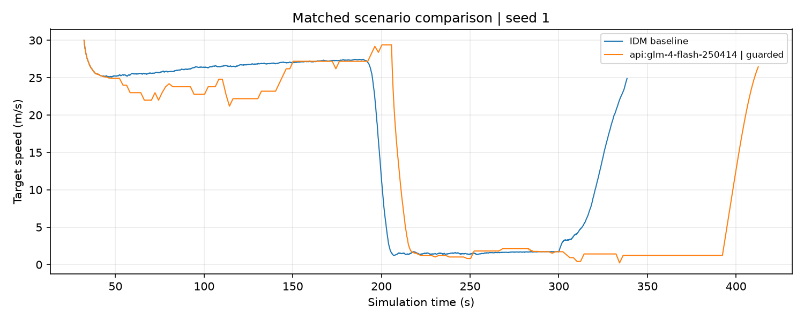
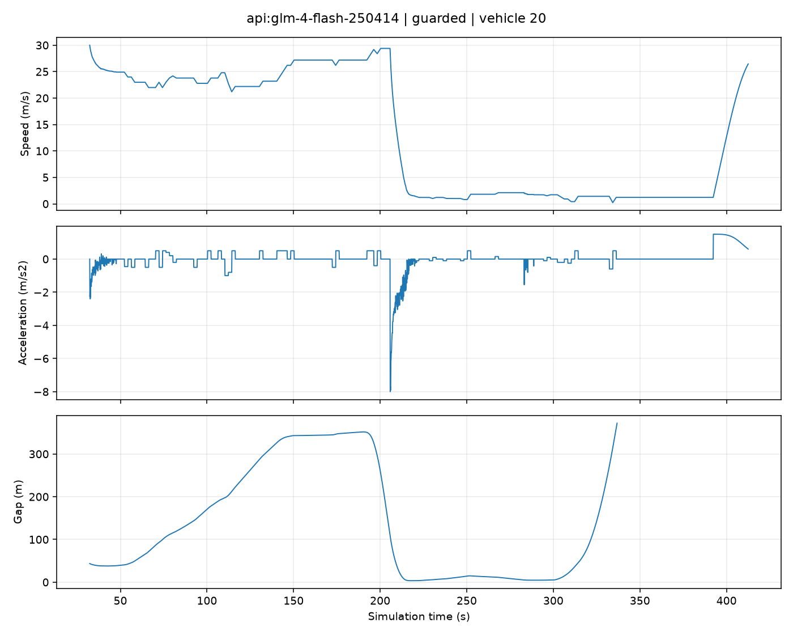
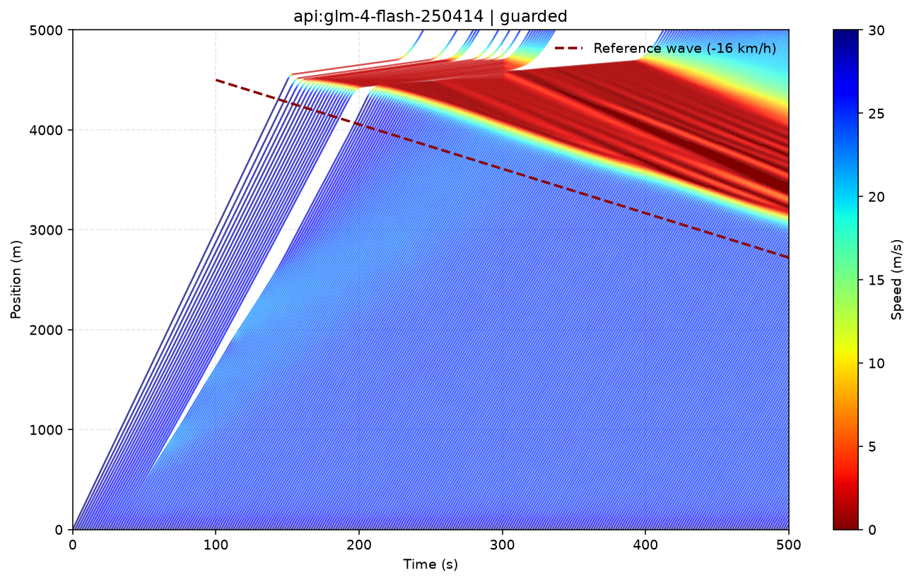

# Real Zhipu API Pilot: Guarded Longitudinal Control

This technical addendum supplements [the offline report](PART2_REPORT.md).
It reports actual model responses separately from rules and mock-transport tests.
Personal reflection and conclusions remain for the student to write.

## Model, setup and reproducibility

- Provider: Zhipu standard model API, `https://open.bigmodel.cn/api/paas/v4`.
- Requested and service-reported model: `glm-4-flash-250414`.
- [Official model documentation](https://docs.bigmodel.cn/cn/guide/models/free/glm-4-flash-250414)
  lists it as free. No paid model was selected; account billing was not independently audited.
- An existing local key was reused through the process environment. No key is
  included in the repository, logs, source snapshots or report.
- Road, bottleneck and physics: supplied experiment 1, 500 s duration, 0.1 s step.
- Only vehicle 20 is controlled by the model; other vehicles retain IDM.
- Decision interval: 2 simulation seconds, with a held acceleration between calls.
- Guard: the same per-step IDM envelope as in the offline experiments.
- One seed (1), matched precomputed inputs and scenario fingerprint with IDM.
- Maximum actual requests: 180; timeout: 30 s; minimum wall-clock request interval: 1 s.
- JSON mode enabled with `response_format={"type":"json_object"}`. Temperature
  and maximum output length were not explicitly set; provider defaults apply.

The command is in [the reproduction guide](PART2_GUIDE.md). The executed source
snapshot and parameters are retained in `part2-zhipu/source_snapshot` and
`part2-zhipu/run-metadata.json`. This pilot adds two runs (matched IDM and guarded
LLM) to the 21 offline runs. The later source adds provider metadata and JSON-mode
support; the earlier offline sources are preserved in their own snapshots.

## Actual integration problem and correction

The initial request reached the service, but strict JSON parsing failed. The
launcher parsed before persisting the response; its raw reply and token usage
were lost. [The initial-attempt record](part2-zhipu-initial-attempt.json) states
that evidence gap explicitly.

A second prompt-only probe persisted the raw reply before interpretation:

````text
```json
{"acceleration": 0.5}
```
````

The Markdown fence was invalid input for `json.loads`, even though the embedded
object looked correct. Enabling provider JSON mode returned a plain JSON object
and passed the same parser. The [failed-format probe](part2-zhipu-probe.json) and
[JSON-mode probe](part2-zhipu-probe-jsonmode.json) preserve the actual replies,
response IDs and usage. The two retained probes report 173 and 225 tokens;
the first attempt's usage is unknown. These probes are separate from the closed-loop
request count and token totals below.

Format compliance does not establish decision quality. In the probe, the vehicle
was approaching a slower leader (20 versus 15 m/s, gap 25 m), yet the model
requested positive acceleration. The guard is therefore an important part of
the tested controller rather than just a formatting check.

## Closed-loop results

| Measurement | Matched IDM | Guarded Zhipu pilot |
| --- | ---: | ---: |
| Admitted vehicles | 295 | 295 |
| Completed trips by 500 s | 127 | 74 |
| Unfinished admitted vehicles | 168 | 221 |
| Target travel time (s) | 306.2 | 380.2 |
| Target minimum bumper gap (m) | 3.073 | 3.495 |
| Full-fleet minimum sampled gap (m) | 2.221 | 1.867 |
| Target acceleration RMS (m/s2) | 0.549 | 0.636 |
| Target jerk RMS (m/s3) | 2.689 | 1.861 |
| Distinct overlapping leader/follower pairs | 0 | 0 |

The target takes 74.0 s longer (about 24.2%). The larger target minimum gap does
not imply the whole fleet has larger gaps: the full-fleet minimum is lower.
Jerk is lower than IDM here, but this occurs alongside substantially slower
progress. Completed-trip mean travel times are affected by the different numbers
of unfinished vehicles, so the table focuses on matched target completion and
counts instead of claiming unbiased average network travel times.







## Model decisions, interventions and budget fallback

The controller makes 191 decision attempts during the target's 3,802 active
integration steps. Exactly 180 produce real API requests; all 180 return
parseable finite acceleration values. The remaining 11 attempts are local
budget-exhaustion events, not provider or parsing failures.

- IDM guard interventions: 256 steps (about 6.7% of target steps).
- Fresh IDM budget-fallback actions: 202 steps (about 5.3%).
- Zero acceleration requested in 134 of 180 successful model decisions.
- The target finishes its trip after budget fallback has begun.

At simulation time 338.3 s, for example, the model receives no active leader,
speed approximately 1.219 m/s and desired road speed 30 m/s, but still returns
zero acceleration. Subsequent zero commands maintain slow progress. Once the
request budget is exhausted, fresh IDM acceleration restores progress and the
target exits. The per-step trace and request log make these phases observable.

Thus this pilot demonstrates a functioning connection between an actual LLM and
the simulator, with a hybrid controller that completes a trip. It does not
demonstrate successful independent LLM control: completion depends on conventional
fallback, and the model's poor progress is a substantive observed limitation.
The safe output format and absence of sampled overlaps do not resolve that issue.

## Latency and reported token usage

For the 180 successful closed-loop requests (including any local pacing within
the decision call):

| Statistic | Value |
| --- | ---: |
| Mean latency | 1.583 s |
| Median latency | 1.425 s |
| Minimum / maximum latency | 1.224 / 5.599 s |
| Requests exceeding the 2 s decision interval | 16 / 180 |
| Reported prompt tokens | 52,638 |
| Reported completion tokens | 2,712 |
| Reported total tokens | 55,350 |

The simulation pauses while requests complete. These times cannot establish
real-time control feasibility; 16 requests already exceed the nominal 2 s
decision period. Token usage is the sum of returned usage fields, not an
independent bill measurement. The local budget-exhaustion events are excluded
from request-latency statistics.

An instrumentation issue was identified during verification: the 11 local
budget events retained the preceding successful response metadata in the
executed version. They are not new service responses and their repeated usage
must not be counted. Raw logs and the executed source snapshot are preserved;
the reported totals filter to the 180 successful requests. The current adapter
clears response metadata before checking its budget, with a regression assertion
covering that behavior.

## Technical limitations and possible next experiments

This is one stochastic service run with one seed and one prompt. It has no
unguarded LLM counterpart or repeated model samples, so neither statistical
superiority nor collision avoidance can be established. API calls succeeding
does not mean the driving decisions are suitable.

Follow-up experiments could explicitly clarify free-road acceleration and
desired-speed tracking in the prompt, then compare that prompt with the present
one under matched conditions. Any such change should be treated as a new policy,
with new logs rather than replacing these results. More scenarios, repeated
model runs, shorter held-action intervals, and carefully measured guard reliance
would help distinguish model quality from conventional-controller assistance.
No such improved-prompt result is claimed here.

Evidence: [summary](part2-zhipu/summary.json),
[metrics](part2-zhipu/seed-1/guarded/metrics.json),
[model replies](part2-zhipu/seed-1/guarded/decisions.jsonl),
[per-step control](part2-zhipu/seed-1/guarded/control.csv),
[target trajectory](part2-zhipu/seed-1/guarded/target.csv).
